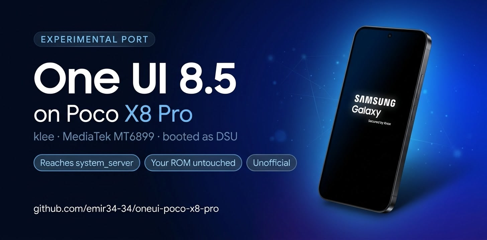

# One UI 9 on the Poco X8 Pro (klee, MT6899) — experimental DSU port

An attempt to run Samsung's One UI 9 system on the Xiaomi Poco X8 Pro (codename `klee`, MediaTek
mt6899), on top of the phone's own Xiaomi vendor. The system is booted as a **DSU** (Dynamic System
Update) image, so the installed ROM and `/data` are never touched. If a test boot fails, the phone
falls back to the normal ROM by itself.

> **Status (2026-11-12): boots and is usable for testing, not for daily use.**
> Sister project: [Ubuntu Touch for the Poco X8 Pro](https://github.com/emir34-34/ubuntu-touch-poco-x8-pro).

## Disclaimer

**Use this at your own risk.** This is an experimental, unfinished port. Even though DSU leaves
the installed system alone, failed boots can put the phone into a preloader/BROM loop for a few
minutes before it recovers. The author takes **no responsibility** for any damage to your device
or data, and gives **no support** for individual attempts. Provided "as is", without warranty of
any kind (GPL-2.0, sections 11 and 12).

This repository contains **no Samsung or Xiaomi files**, only patches, scripts and notes. You
need to download the firmware yourself.

## Status

| Area | Status |
|---|---|
| Boot, Galaxy S26 Ultra lock screen and notification panel, ADB | ✅ |
| Boot time | ✅ screen at ~50–63 s |
| PIN lock | ✅ |
| In-display fingerprint (enrol, unlock) | ✅ |
| Samsung fingerprint unlock animation (Good Lock / LockStar) | ✅ |
| Always On Display | ✅ |
| Wi-Fi, Google and Samsung sign-in | ✅ |
| Fast charging | ✅ ~35–55 W |
| Lock screen elements around the sensor | 🟡 icon size being tuned |
| Adaptive brightness | ❌ light sensor reports an almost constant value |
| SMS, VoLTE, SIM manager | ❌ |
| Theme Store, Gallery AI editing | ❌ |
| Camera, Bluetooth, GPS, calls, mobile data | not tested |

How each fix works is in **[NOTES.md](NOTES.md)**.

## Base

- System: Galaxy A06 5G (SM-A066B) One UI 9, with SystemUI, AODService and Galaxy AI apps from
  the Galaxy S26 Ultra.
- Kernel, vendor, odm: from the phone (Infinity X, Android 17, vendor API 202604).

## Repository layout

| Path | Contents |
|---|---|
| `NOTES.md` | everything learned: the fixes, why they are needed, the test loop |
| `tools/build_image.sh` | builds the EROFS `system.img` with the AVB hashtree footer |
| `tools/dsu_cycle.sh`, `tools/auto_install.sh` | install the image as DSU (32 GiB userdata), skip setup, collect a diagnosis |
| `tools/diag_oneui.sh` | read-only diagnosis (logcat, dumpsys, props) while One UI runs |
| `tools/build_module.sh`, `tools/push_module.sh` | build and push a small add-on module instead of a new 6 GB image |
| `tools/kleemod/klee_modmount.{sh,rc}` | module loader: overlayfs mounts before zygote, skips a module that broke the boot |
| `tools/kleemod/klee_fpfs.c` | adds `/sys/class/fingerprint/fingerprint/position`, which Samsung's lock screen and AOD read |
| `tools/build_services_mod.sh` | rebuilds `services.jar` / `secinputdev-service.jar` from smali, replacing only the dex files |
| `patches/` | smali diffs against the stock One UI 9 `services.jar` and `secinputdev-service.jar` |
| `overlay/KleeFramework/` | framework overlay source: brightness curve, AOD brightness, hysteresis |
| `module-example/` | an example module (`mod.list`, `mod.prop`, root helper script) |
| `sepolicy/oneuidbg.cil` | the permissive debug domain used by the development tools |
| `docs/` | banners and a photo of the device |

The loader, `klee_fpfs`, the debug domain and the helper scripts are **development tools** and are
meant to be removed before any permanent install.

## Screenshot

*The Poco X8 Pro booting the One UI DSU image (photo of the real device).*

## Banners

The banner at the top was made with ChatGPT from the photo of the real device. Two
alternatives, free to use for posts about the project:

| `docs/banner2.jpg` (Gemini) | `docs/banner3.png` (hand-made from the photo) |
|---|---|
|  |  |

## Credits

Samsung firmware download: [samloader-rs](https://github.com/topjohnwu/samloader-rs). Tools:
apktool, erofs-utils, AOSP avbtool and secilc. Thanks to the Poco X8 Pro community.

## License

GPL-2.0 for the scripts, patches and notes in this repository. Samsung's and Xiaomi's software
remains the property of its owners and is not included.
