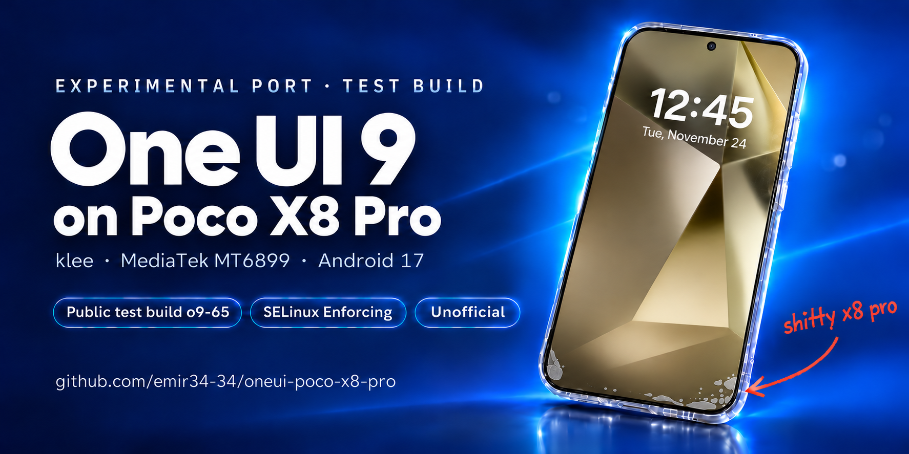
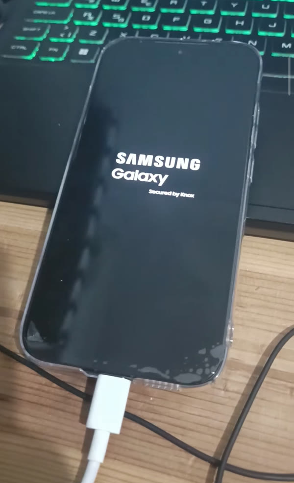
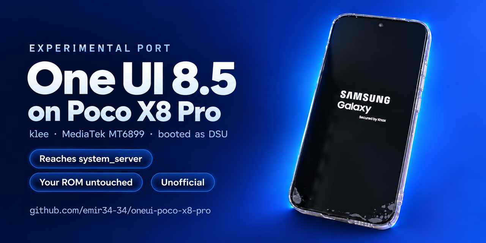
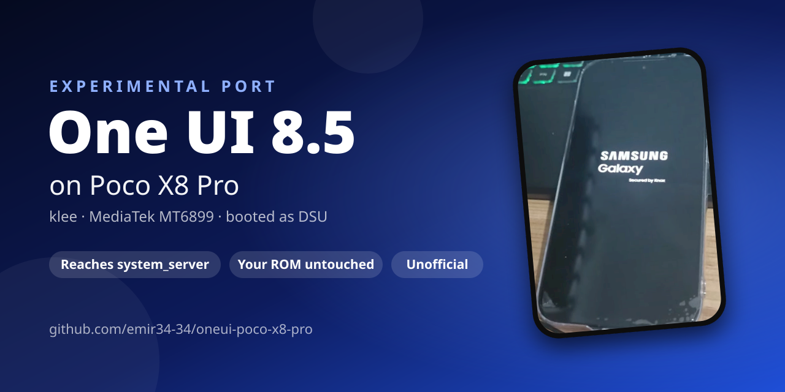

# One UI 9 on the Poco X8 Pro (klee, MT6899) — experimental port

An attempt to run Samsung's One UI 9 system on the Xiaomi Poco X8 Pro (codename `klee`, MediaTek
mt6899), on top of the phone's own Xiaomi vendor. The system is booted as a **DSU** (Dynamic System
Update) image, so the installed ROM and `/data` are never touched. If a test boot fails, the phone
falls back to the normal ROM by itself.

> **Status (2026-11-24): public TEST build o9-65 is out — not for daily use.** Download and install
> steps: [Test release](#test-release-o9-65). Ran as the author's daily phone (normal install, slot B,
> SELinux Enforcing) from 2026-11-16. Some features are missing or buggy, see the table.
> Sister project: [Ubuntu Touch for the Poco X8 Pro](https://github.com/emir34-34/ubuntu-touch-poco-x8-pro).

## Disclaimer

**Use this at your own risk.** This is an experimental, unfinished port. Even though DSU leaves
the installed system alone, failed boots can put the phone into a preloader/BROM loop for a few
minutes before it recovers. The author takes **no responsibility** for any damage to your device
or data, and gives **no support** for individual attempts. Provided "as is", without warranty of
any kind (GPL-2.0, sections 11 and 12).

This repository contains **no Samsung or Xiaomi files**, only patches, scripts and notes. You
need to download the firmware yourself.

## Status

| Area | Status |
|---|---|
| Boot, Galaxy S26 Ultra lock screen and notification panel, ADB | ✅ |
| Boot time | ✅ screen at ~50–63 s |
| Normal install in place of Infinity X (slot B), SELinux Enforcing | ✅ data kept on updates, see [docs/NORMAL_INSTALL.md](docs/NORMAL_INSTALL.md) |
| PIN / pattern lock | 🟡 after a reboot unlock with PIN/pattern first: fingerprint can dismiss the lock screen while storage stays locked |
| In-display fingerprint (enrol, unlock), LockStar animation | ✅ |
| Always On Display | ✅ |
| Wi-Fi, Google and Samsung sign-in | ✅ |
| Fast charging | ✅ ~35–55 W |
| Adaptive brightness | ✅ under-display light sensor works |
| Flashlight with strength levels | ✅ |
| Xiaomi camera (photos saved) | ✅ |
| Bluetooth audio (A2DP offload) | 🟡 plays, but a tester reports audio routing back to the speaker |
| SIM, mobile data, SMS in/out | ✅ |
| Voice calls (outgoing and incoming) | 🟡 partial: calls connect with two-way audio, but incoming calls can arrive late |
| Lock screen / AOD clock on a clean install | ✅ |
| 120 Hz option in Motion smoothness | ✅ added "High" (fixed 120 Hz) next to Adaptive/Standard |
| Galaxy S24 Ultra Infinity video wallpapers, One UI 8.5 animated graphical wallpapers | ✅ |
| KleeToys camera-ring LED, S26 Ultra sound themes | ✅ |
| 5G | 🟡 option shown, network stays on LTE (NR restricted) |
| VoLTE / VoWiFi, MMS | ❌ |
| Theme Store, Gallery AI editing | ❌ |

How each fix works is in **[NOTES.md](NOTES.md)**.

## Test release (o9-65)

**Not for daily use.** For testers who can read logcat, ideally with an AI coding assistant.

- Download (Google Drive, 7.1 GB): *link coming soon*
  SHA-256 `a5813e3d14e956c83571fee611f494a524a60d8e07d394fff8c9f6f279bb0bdd`
- The zip holds `super.img` (One UI + Infinity X 4.1 vendor), Infinity X 4.1 kernel/boot images and
  firmware, and the scripts in [`release/`](release/). It is hosted outside this repository because
  it contains Samsung and Xiaomi software.
- **Recommended:** let an AI coding assistant (Claude Code etc.) guide the install: open it in the
  extracted folder and paste [`release/AI_INSTALL_PROMPT.txt`](release/AI_INSTALL_PROMPT.txt). It runs
  the checks, then starts the installer in a separate terminal with a progress bar; you type YES yourself.
- Requirements: Fenrir lk + preloader, a **full backup of all partitions**, platform-tools.
  Never flash or erase IMEI partitions (nvram, nvdata, nvcfg, persist, protect1/2, md_sec, proinfo,
  seccfg).
- [`release/install_linux.sh`](release/install_linux.sh) / [`install_windows.bat`](release/install_windows.bat)
  flash the **current active slot** and never run `set_active` (switching to a slot whose preloader
  does not boot drops this phone to BROM). Userdata and metadata are wiped. Preloader and lk are
  not written.
- Tested on slot B. Slot A uses the same image plus a 1 MiB metadata patch
  ([`tools/make_slot_meta_patch.py`](tools/make_slot_meta_patch.py)) and is **untested**.
- Known bugs: fingerprint as first unlock after reboot (see above), Bluetooth audio routing, Samsung
  IMS (`imsd`) crash loop (no VoLTE), Play Integrity BASIC only, DSU PIN workarounds still inside,
  shutdown not fully clean.
- **Debug build on purpose:** ADB is on from the first boot with **no authorization prompt**
  (`ro.adb.secure=0`, `ro.debuggable=1`), so testers can pull logs and debug from minute one. It also
  means anyone with a USB cable can access the phone: don't keep personal data on it.
- Bug reports: steps + `adb logcat -b all -d`. Developers who can fix bugs: contact me on Telegram.

## Base

- System: Galaxy A06 5G (SM-A066B) One UI 9, with SystemUI, AODService and Galaxy AI apps from
  the Galaxy S26 Ultra.
- Kernel, vendor, odm: from the phone (Infinity X, Android 17, vendor API 202604).

## Repository layout

| Path | Contents |
|---|---|
| `NOTES.md` | everything learned: the fixes, why they are needed, the test loop |
| `tools/build_image.sh` | builds the EROFS `system.img` with the AVB hashtree footer |
| `tools/dsu_install_file.sh` | install the image as DSU from Infinity X: push, then pipe into `gsi_tool` on the phone (32 GiB userdata, no reboot) |
| `tools/dsu_cycle.sh`, `tools/auto_install.sh` | older install + diagnosis loop |
| `tools/secil_test.sh` | compiles the split SELinux policy like `init` does, before building an image |
| `tools/build_split.sh` | splits the tree into `system`, `system_ext`, `product` images (preparation for a normal install) |
| `tools/kleevendor/` | binds patched vendor RIL libraries from `/system/etc/klee_vendor` over `/vendor/lib64` before `rild` starts |
| `tools/diag_oneui.sh` | read-only diagnosis (logcat, dumpsys, props) while One UI runs |
| `tools/build_module.sh`, `tools/push_module.sh` | build and push a small add-on module instead of a new 6 GB image |
| `tools/kleemod/klee_modmount.{sh,rc}` | module loader: overlayfs mounts before zygote, skips a module that broke the boot |
| `tools/kleemod/klee_fpfs.c` | adds `/sys/class/fingerprint/fingerprint/position`, which Samsung's lock screen and AOD read |
| `tools/build_services_mod.sh` | rebuilds `services.jar` / `secinputdev-service.jar` from smali, replacing only the dex files |
| `patches/` | smali diffs against the stock One UI 9 `services.jar`, `secinputdev-service.jar` and `framework.jar` (flashlight levels) |
| `overlay/KleeFramework/` | framework overlay source: brightness curve, AOD brightness, hysteresis |
| `module-example/` | an example module (`mod.list`, `mod.prop`, root helper script) |
| `sepolicy/oneuidbg.cil` | the permissive debug domain used by the development tools |
| `sepolicy/camera-bgservice.cil` | lets the Xiaomi camera reach its image-processing service |
| `docs/NORMAL_INSTALL.md` | the normal install: `super` layout, flashing, first-boot rule, what is still open |
| `tools/build_normal_super.sh` | builds the full `super.img` (One UI system/system_ext/product + the phone's vendor/odm/dlkm) with `lpmake` |
| `tools/normal_kur_ilerleme.sh`, `tools/normal_guncelle_ilerleme.sh`, `tools/fastboot_ilerleme.py` | first install (with format) / update keeping data, with a progress bar |
| `tools/apk_swap_entry.py` | replaces a file inside a system APK (e.g. a dex) with one of a different size, keeping the original APK Signing Block |
| `tools/apk_graft_sig.py` | puts the original signing block on an APK rebuilt with apktool (to add resources) |
| `tools/wallpaper_merge_s24u.py` | merges the S24 Ultra Infinity entries into `wallpaper-res`'s `resources_info.json` |
| `patches/SecSettings-120hz.patch` | smali diff adding the 120 Hz "High" option to Motion smoothness |
| `sepolicy/normal_install_enforcing.cil` | rules Samsung's system side needs under Enforcing |
| `release/` | install scripts and README of the public test package (active slot, no `set_active`) |
| `tools/make_slot_meta_patch.py` | sparse patch that rewrites only super's LP metadata for slot A |
| `tools/payload_extract.py` | minimal `payload.bin` extractor (stock `init_boot`/`vbmeta` from the Infinity X OTA) |
| `docs/` | banners and a photo of the device |

The loader, `klee_fpfs`, the debug domain and the helper scripts are **development tools** and are
meant to be removed before any permanent install.

## Screenshot

*The Poco X8 Pro booting One UI (photo of the real device).*

## Banners

The banner at the top (`docs/banner.png`, One UI 9 test build) was made with ChatGPT from the photo
of the real device. Free to use for posts about the project.

### Outdated banners

From the One UI 8.5 / DSU days, kept for history.

| `docs/banner_old.png` (ChatGPT) | `docs/banner2.jpg` (Gemini) | `docs/banner3.png` (hand-made from the photo) |
|---|---|---|
|  |  |  |

## Credits

Samsung firmware download: [samloader-rs](https://github.com/topjohnwu/samloader-rs). Tools:
apktool, erofs-utils, AOSP avbtool and secilc. Thanks to the Poco X8 Pro community.

## License

GPL-2.0 for the scripts, patches and notes in this repository. Samsung's and Xiaomi's software
remains the property of its owners and is not included.
